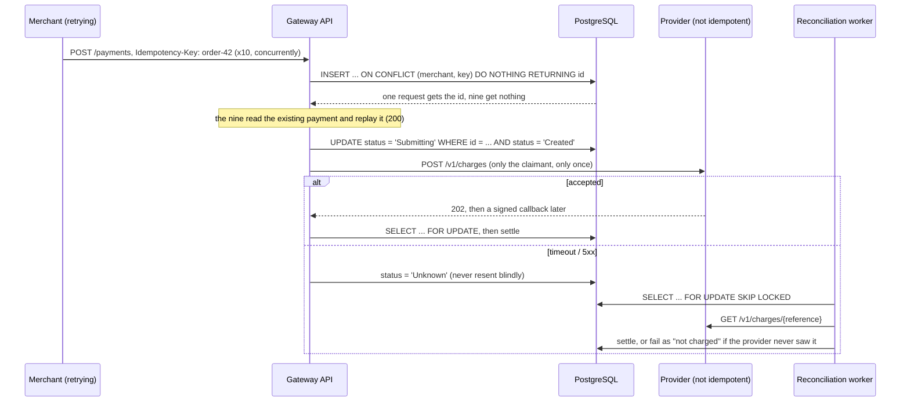

# mobile-money-gateway-sandbox

[](https://github.com/momosto/mobile-money-gateway-sandbox/actions/workflows/ci.yml)

**A mobile money payment gateway that can't charge a customer twice, even when a thousand requests arrive at once.**

.NET 8 minimal APIs, EF Core and PostgreSQL, a reconciliation worker, and a deliberately unreliable simulated mobile money provider (in the style of EcoCash or OneMoney). The provider charges **every** request it receives, so the gateway alone has to guarantee one charge per payment.

## Proof

**1,000 concurrent requests for 100 orders, with the provider failing at random:**

```
1000 requests for 100 orders in 14.6s; HTTP status counts: {201: 100, 200: 900}
gateway payments for this run: 100; by status: {Succeeded: 83, Failed: 16, Reversed: 1}
provider ledger: {"charges": 93, "references": 93, "referencesChargedMoreThanOnce": 0, "succeeded": 83, "debitedCents": 207500}
PASS: no order was charged twice
```

- **Zero double charges.** Each order was charged at most once. The 900 duplicates were answered from the database with `Idempotent-Replayed: true`, and none reached the provider.
- **The books balance.** The provider took USD 2,075.00 from 83 successful charges, exactly the 83 payments the gateway marked *Succeeded*.
- **Every failure ended in a definite state.** 7 orders hit a provider error before any charge and were marked *failed, not charged*. Insufficient funds became *Failed*. One settlement for the wrong amount was automatically *Reversed*. Charges where the provider took the money and then went silent past the 3 s timeout were found by the reconciliation worker and settled, never resent.

The same test runs in CI on every push (k6 against `docker compose`): `load/double-charge.js`, or `load/double_charge.py` for machines without k6 or Docker. The run above was on a Windows laptop against PostgreSQL 15.

**Integration tests** (xUnit, real PostgreSQL via Testcontainers, a counting fake provider):

| Test | What it proves |
|---|---|
| 200 identical requests at once | 1 payment, 1 provider charge |
| 1,000 requests across 100 keys at once | exactly 100 charges, none repeated |
| retry of a finished request | same payment back, `Idempotent-Replayed: true` |
| same key, different amount | 422, no second charge |
| signed callback, then a late contradicting one | settles once; final status never changes |
| forged callback signature | 401, payment untouched |
| settlement for the wrong amount | reversed at the provider |
| timeout, provider has no record | failed as *not charged*, never resent |
| timeout, provider did charge | settled as *Succeeded*, never resent |
| lost callback | settled by reconciliation |
| provider down during reconciliation | payment left alone, settled on the next run |
| two reconcilers at once | each payment handled exactly once |
| missing key, bad body, wrong merchant | 400 / 401, nothing charged |

## How it stops double charges



1. **The database decides who owns a payment.** A unique index on `(merchant_id, idempotency_key)` and `INSERT ... ON CONFLICT DO NOTHING` let exactly one concurrent request create the row. There's no check-then-insert race, because there's no check.
2. **Only the owner may submit.** `UPDATE ... SET status = 'Submitting' WHERE status = 'Created'` is the only way to reach the provider, and it can succeed once.
3. **A timeout is "unknown", not "failed".** The customer may have been charged. The gateway never resends; the worker asks the provider what happened.
4. **Settlement is serialised.** Callbacks lock the row with `FOR UPDATE`, and a payment that is already final is never changed, so duplicate or late callbacks are harmless.
5. **Workers scale out safely.** `FOR UPDATE SKIP LOCKED` hands each worker a different batch.
6. **The provider is checked, not trusted.** A settlement for a different amount than requested is reversed. Callbacks must carry a valid HMAC-SHA256 signature, compared in constant time.

Payment statuses: `Created → Submitting → Pending | Unknown → Succeeded | Failed | Reversed`.

## Run it in 2 minutes

```bash
git clone https://github.com/momosto/mobile-money-gateway-sandbox && cd mobile-money-gateway-sandbox
docker compose up --build                              # API :5080, provider :5090, worker, PostgreSQL
docker compose --profile loadtest run --rm loadtest    # the 1,000-request double-charge test
```

- Swagger UI: http://localhost:5080/swagger
- Transactions page: http://localhost:5080 (API key `demo-merchant-key`)

```bash
curl -X POST http://localhost:5080/payments \
  -H "X-Api-Key: demo-merchant-key" -H "Idempotency-Key: order-1001" -H "Content-Type: application/json" \
  -d '{"msisdn":"263771234567","amountCents":2500,"currency":"USD"}'
```

Without Docker: run `dotnet test` with `GATEWAY_TEST_DB` set to a PostgreSQL connection string, or start the three apps with `dotnet run` and run `python load/double_charge.py`.

## API

| Endpoint | Purpose |
|---|---|
| `POST /payments` | Charge a wallet. Needs `X-Api-Key` and `Idempotency-Key`. 201 new, 200 replay, 422 key reused with a different body |
| `GET /payments/{id}` | One payment (own merchant only) |
| `GET /payments?status=&limit=` | Recent payments |
| `POST /webhooks/provider` | Provider callback, `X-Provider-Signature` HMAC-SHA256 |
| `GET /health` | Database reachable |

The simulator (`src/ProviderSimulator`) exposes `POST /v1/charges`, `GET /v1/charges/{reference}`, `POST /v1/charges/{reference}/reverse` and `GET /v1/stats`. Its fault rates are configurable under `Simulator`:

| Fault | Default rate |
|---|---|
| Error before charging | 5% |
| Charge, then go silent for 30 s | 3% |
| Lose the callback | 10% |
| Insufficient funds | 10% |
| Settle the wrong amount | 1% |

## Bugs the end-to-end run caught

Running the three services together under load found two problems the unit tests had not:

- **The worker died during a provider outage.** An HTTP timeout is an `OperationCanceledException` in .NET, and the worker treated every such exception as "shutting down". The fix: only an actual shutdown ends the loop, and each payment's provider call is isolated, so an outage just postpones that payment. There's now a test for it.
- **The simulator dropped settlements when the gateway hung up.** That isn't how real providers behave, so it now settles independently of the HTTP request.

## Project layout

```
src/Gateway.Core/        payment model, EF Core context + migration, PaymentService, ReconciliationService, provider client
src/Gateway.Api/         minimal API, auth, validation, webhook, Swagger, transactions page
src/Gateway.Worker/      reconciliation BackgroundService
src/ProviderSimulator/   unreliable, non-idempotent mobile money provider
tests/Gateway.Tests/     integration tests on real PostgreSQL
load/                    k6 and Python double-charge load tests
```

## What a production version would add

- Outbox for merchant notifications, so "payment succeeded" events survive a crash
- Expiry for payments the provider keeps pending for hours
- Per-merchant rate limits and key rotation; secrets from a vault rather than config
- OpenTelemetry traces across gateway, worker and provider calls

MIT licensed. Built by [Simbarashe Nyamusa](https://simbarashe-nyamusa.vercel.app), from experience building and running a production mobile money gateway. No employer code is used.
